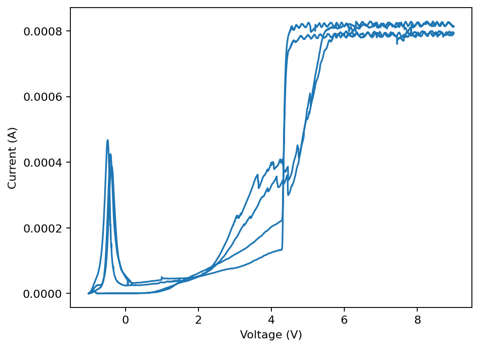

# PyElectrochemReader

A small Python library for reading electrochemical measurement files.

Requires Python 3.10 or newer.

```sh
python3 -m pip install .
python3 -m pip install matplotlib
```

Matplotlib is optional and is used here to plot the included MPR example.
Run this code from the repository root:

```python
from pyelectrochemreader import read
import matplotlib.pyplot as plt

data = read("example/data/CV_C01.mpr")[0]
plt.plot(data["voltage"], data["current"])
plt.xlabel("Voltage (V)")
plt.ylabel("Current (A)")
plt.show()
```



Only request signals that the instrument recorded: an open-circuit dataset,
for example, might have no current column. Use `"current" in data` to check.

For a dataset with aligned time, voltage, and current signals, you can also
plot voltage and current against time:

```python
import matplotlib.pyplot as plt
from pyelectrochemreader import read

data = read("measurement.mpr")[0]

fig, axes = plt.subplots(2, 1, sharex=True, layout="constrained")
axes[0].plot(data["time"], data["voltage"])
axes[0].set_ylabel("Voltage (V)")

axes[1].plot(data["time"], data["current"] * 1000)
axes[1].set_ylabel("Current (mA)")
axes[1].set_xlabel("Time (s)")

# Optional: save the figure before opening the plot window.
# fig.savefig("measurement.png", dpi=300)
plt.show()
```

See [example/](example/README.md) for one sample file per available format,
the [plot gallery](example/index.html), and a script to regenerate the plots.

| Extension | Instrument / supported layouts |
| --- | --- |
| `.nox` | Metrohm Autolab NOVA NRBF object graphs; calculated numeric command signals |
| `.mpr` | Bio-Logic EC-Lab/BT-Lab; legacy and 11.50 module headers, data versions 0, 2, 3 |
| `.mpt` | Bio-Logic tab-separated ASCII; decimal dots or commas |
| `.dta` | Gamry EXPLAIN tables, multiple curves, EIS, OCV, VFP600 |
| `.nda` | Neware versions 29 and 130, including BTS 9 and 9.1 record families |
| `.ndax` | Neware ZIP archives containing NDC versions 2, 5, 11, 14 |
| `.res` | Arbin Jet 3/4 `Channel_Normal_Table`, decoded directly in Python |
| `.par` | Princeton Applied Research VersaStudio ASCII segments |
| `.cor` | CorrWare ASCII, including current-density columns |
| `.csv`, `.txt`, `.tsv` | Delimited tables, with or without column headers |
| `.xlsx`, `.xls` | OOXML workbooks, including XLSX content saved with an `.xls` suffix |
| `.ods` | OpenDocument spreadsheets |

These are supported format families, not a promise to decode every proprietary
variant or every electrochemical instrument. Unknown binary versions, column
widths, and unsupported measurement types raise `UnsupportedFormatError`
instead of guessing a layout. Corrupt files and files without measurements
raise `ReadError`. Both exceptions inherit from `ValueError`; filesystem errors
such as `FileNotFoundError` remain filesystem errors.

PAR and COR support was checked against the examples in
[PySimpleEChem](https://github.com/kevinsmia1939/PySimpleEChem). PAR segments
preserve all recorded columns. COR files labelled `I(A/cm2)` expose
`data["current_density"]` in A/cm²; they do not acquire a `current` alias because
the recorded values are normalized by electrode area.

CSV/TXT/TSV readers detect comma, semicolon, tab, or whitespace separators.
Column headers and their units are preserved. Headerless numeric tables follow
PySimpleEChem's convention: the first column is potential in V and the second
is current in A. No first data point is dropped. Use explicit overrides when
automatic detection is ambiguous:

```python
data = read("measurement.csv", delimiter=";", header=True)[0]
data = read("measurement.txt", delimiter="whitespace", header=False)[0]
```

XLSX and ODS files are read with the standard-library ZIP/XML modules. Each
worksheet or repeated battery measurement table becomes a dataset. Stored
numbers, text, missing cells, and cached formula results are preserved; formulas
are not recalculated. Time-formatted Excel cells and explicit elapsed-time
strings are decoded to seconds. The PySimpleEChem battery `.xls` example is an
OOXML workbook; genuine legacy binary XLS/OLE/BIFF files remain unsupported.
No pandas, openpyxl, xlrd, or odfpy dependency is required.

`read()` accepts paths and binary streams, with case-insensitive extensions:

```python
from io import BytesIO
from pyelectrochemreader import read, ReadError

experiment = read(BytesIO(raw_bytes), format="ndax")
experiment = read("export.MPT", encoding="latin1")

for dataset in experiment:
    print(dataset.name, len(dataset), dataset.column_names)
```

Streams are read from their current position and left open. Text decoding
defaults to UTF-8 with a Windows-1252 fallback. An explicit `encoding` overrides
that choice for MPT/DTA files.

`Experiment` contains `datasets`, `format`, `metadata`, and `source`.
`len(experiment)` counts datasets. Each `Dataset` contains `columns` (a dictionary
of one-dimensional NumPy arrays), `units`, `name`, and `metadata`.
`len(dataset)` is its longest signal's length. NOVA signals can have unequal
lengths; `to_numpy()` requires the selected columns to have equal lengths.
Arrays may be views of immutable input buffers; call `.copy()` before editing.

Aliases are available when a suitable native column exists:

| Alias | Unit |
| --- | --- |
| `time` | s |
| `voltage` | V |
| `current` | A |
| `current_density` | A/cm² |
| `frequency` | Hz |
| `charge_capacity`, `discharge_capacity` | Ah |
| `capacity` | Ah |
| `cycle`, `step` | recorded counters |

Native names take precedence over aliases. No alias estimates missing signals.
Neware `Time` is the recorded step time, so its `time` alias can reset between
steps. Neware NDA step identifiers are preserved; cycle numbers are not
regenerated, and NDA 130 has no cycle column because these records do not
contain one. NDA 29 recorded zero-based cycle indices are exposed starting at 1.
NDA records are sorted by index, retaining the first occurrence of duplicates.

NDAX's first dataset holds sampled voltage/current with supplemental values
joined by index. **Missing time, capacity, and timestamp observations remain
`NaN`/`NaT`; no values are interpolated or integrated.** For split NDC layouts,
the following `run_info` and `steps` datasets preserve the supplemental records,
including duplicate run indices. At duplicate indices the primary table uses
the first time/capacity observation; the complete records are in `run_info`.
Step assignments carry forward between recorded boundaries. Auxiliary datasets
are also available individually and joined to the primary table by index.

Timestamp arrays use NumPy `datetime64`. Epoch-based Neware timestamps represent
UTC. Calendar dates in NDA 29 and Access dates in RES have no recorded timezone;
no local timezone is inferred. NOVA timestamps are Python `datetime` metadata.
The NOVA decoder interprets serialization as data without loading assemblies
or instantiating serialized classes. It exposes calculated signals rather than
retaining the large internal ADC sample objects.

Binary numeric records use NumPy buffer views or batch decoding; unit aliases
convert on access. NDAX members are read in memory without extraction. The RES
reader indexes database pages once and decodes fixed numeric tables in batches.
Files are currently read into memory; there is no streaming/chunked API.

Tests use the standard-library `unittest` runner and NumPy:

```sh
PYTHONPATH=src python3 -W error -m unittest discover -v

# Also check the example repository's instrument files, when available:
ECHEM_REFERENCE=/path/to/echem-data-viewer \
  PYTHONPATH=src python3 -W error -m unittest discover -v

# Also validate the new readers against PySimpleEChem's example files:
PYSIMPLEECHEM_REFERENCE=/path/to/PySimpleEChem \
  PYTHONPATH=src python3 -W error -m unittest discover -v

# Measure read times for your own files:
python3 benchmarks/read_files.py /path/to/files --repeat 3
```

The optional reference suite checks 55 fixtures: 54 readable files and one
intentionally header-only file that must raise `ReadError`. NOX is tested using
a synthetic NRBF procedure; the reference checkout contains no NOX fixture.

The package is GPL-3.0-or-later. Adapted layout tables and serialization code
retain their notices; see [THIRD_PARTY_NOTICES.md](THIRD_PARTY_NOTICES.md) and
[LICENSE](LICENSE).
